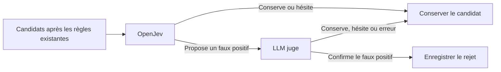

# OpenJev avant le LLM juge : analyse des benchmarks

Analyse du 29 septembre 2026, sur le workspace au commit `d9cb8df15c97214648b78a2faeede2b564270ef8`, avec ses modifications locales préexistantes.

Délibération : [fil Mattermost AIS-DEL-20260929-openjev-prefilter](http://localhost:8065/agents/pl/666edgi91bgdbds8a7j5wbi3wh). Deux analyses indépendantes, GPT et Claude, suivies d'une revue croisée. Les chiffres ci-dessous proviennent des prédictions sauvegardées, appariées par candidat ; aucune nouvelle inférence n'a été lancée.

## Avis

**OpenJev peut améliorer la précision avant le juge, mais les benchmarks ne justifient pas son activation globale comme préfiltre éliminatoire pour accélérer la chaîne.** Le gain de précision est mesuré ; le gain de temps de la cascade ne l'est pas. Avec un juge déjà efficace, le bénéfice supplémentaire est faible et accompagné de pertes supplémentaires de vrais positifs.

Le prochain essai utile est une comparaison sur de vrais candidats Confluence, après les filtres déterministes. Le routage intermédiaire proposé par Claude — conserver directement les candidats que les scores OpenJev favorisent nettement, puis faire juger les autres par GPT — obtient le meilleur compromis observé selon l'utilité λ=10. Une variante encore plus conservatrice fait confirmer uniquement les rejets proposés par OpenJev. Ces variantes réduisent beaucoup plus les appels, en échange d'une précision finale inférieure au juge complet ; leurs résultats restent exploratoires.

## Ce que signifie « 30 % de FP retirés »

Le [rapport OpenJev](../../../benchmarks/pii-judge-dataset-eval/RAPPORT-OPENJEV.md) porte sur Qwen3.5-4B avec le prompt `per_type`, seuil de rejet 0. Le modèle choisit entre trois options ; il ne génère pas de justification. C'est néanmoins un LLM, et non un filtre déterministe.

Sur le test réservé de 2 360 candidats :

- Avant filtre : 1 197 vrais candidats et 1 163 faux, précision **50,72 %**.
- Après OpenJev : 1 193 vrais candidats et 809 faux, précision **59,59 %**.
- **354/1 163 = 30,44 %** des faux positifs éliminés ; **4/1 197 = 0,33 %** des vrais positifs perdus.
- **358/2 360 = 15,17 %** des appels au juge évités, si tous les candidats lui étaient initialement destinés. Quatre de ces appels évités correspondent à des erreurs du filtre selon les annotations.

Le rappel de 99,67 % est la conservation des vrais candidats déjà détectés. Il ne mesure pas le rappel de toute la détection. Les quatre pertes correspondent à trois contextes distincts, à cause d'un alias de carte bancaire.

La précision de départ change le bénéfice. À taux d'élimination et de rétention identiques, une précision initiale de 80 % deviendrait **85,14 %**, avec **6,36 % d'appels évités** ; à 90 %, elle deviendrait **92,80 %**, avec **3,34 % d'appels évités**. Ces exemples sont des projections sous hypothèses constantes, pas des mesures de production.

Formule, avec `p` la précision d'entrée, `r = 1193/1197` la rétention des vrais candidats et `f = 809/1163` la rétention des faux : `P_après = p*r / (p*r + (1-p)*f)`. La part d'appels évités vaut `1 - p*r - (1-p)*f`.

## Rejeu de la cascade complète

Les campagnes [OpenJev](../../../benchmarks/pii-judge-dataset-eval/results/openjev-calibration/RAPPORT.md) et [GPT-OSS](../../../benchmarks/pii-judge-dataset-eval/results/gpt-oss-calibration/RAPPORT.md) partagent exactement le dataset et les partitions calibration/test. Le [script de vérification](replay.py) contrôle l'empreinte du dataset, l'unicité et l'égalité des identifiants. Les seuils restent ceux sélectionnés avant le test ; aucun réglage n'a été optimisé pour cette analyse.

La cascade demandée rejette si OpenJev rejette, puis applique GPT aux survivants. Dans un rejeu des décisions archivées, ses rejets sont donc l'union des rejets des deux juges, sans supposer leurs erreurs indépendantes. `UNSURE`, les erreurs et les réponses non interprétables restent conservés.

| GPT-OSS et seuil | Précision seul → cascade | Rétention TP seul → cascade | FP supplémentaires éliminés | TP supplémentaires perdus |
|---|---:|---:|---:|---:|
| `general`, 0,8 | 80,88 → 82,66 % | 85,55 → 85,21 % | 28 | 4 |
| `per_type_financial_only`, 0,999 | 51,18 → 59,99 % | 99,92 → 99,58 % | 346 | 4 |
| `checklist`, 0,975, meilleur F1 | 86,40 → 87,72 % | 93,40 → 93,07 % | 20 | 4 |

**Avec le meilleur F1 GPT-OSS, 334 des 354 FP retirés par OpenJev étaient déjà retirés par GPT.** L'amélioration marginale est de 20 FP contre quatre TP perdus. Au coût choisi dans ces benchmarks — une PII perdue vaut dix FP éliminés — l'utilité passe de 0,169 à 0,152. L'opération est défavorable selon ce critère, malgré la hausse de précision et de F1.

Les quatre TP rejetés par OpenJev étaient conservés par chacun des trois bras GPT. Un juge en aval ne peut pas récupérer un candidat qu'il ne reçoit plus.

Le bras GPT très conservateur gagne davantage avec OpenJev, mais la cascade reste très proche d'OpenJev seul : 59,99 % contre 59,59 % de précision, au prix d'une PII perdue supplémentaire et de 2 002 appels GPT. Ce bras n'établit pas l'intérêt économique des deux modèles.

## Pourquoi la vitesse n'est pas acquise

Le réglage OpenJev qui retire 30,44 % des FP coûte **1,181 s de latence médiane**, contre 0,364 s pour le prompt initial. Il ne faut pas associer la vitesse du prompt initial à la qualité du prompt par type. Le [test de lots](../../../benchmarks/pii-judge-dataset-eval/results/openjev-calibration/batch-check.json) sur douze candidats n'améliore pas le temps avec des lots de quatre ou huit sur cette configuration MPS.

**Le temps mural n'a pas été mesuré pour la cascade.** Sur les 2 360 candidats du rejeu, OpenJev coûte **45,79 minutes cumulées**. Les appels GPT évités totalisent 42,55 minutes pour `general`, 44,69 minutes pour le réglage conservateur et 53,50 minutes pour `checklist`. L'addition brute de ces latences change cette somme de **+1,12 %, +0,36 % et −2,03 %** respectivement : OpenJev absorbe presque toute l'économie calculée dans cette projection.

**Ces valeurs ne sont pas des durées réelles de cascade.** GPT a été mesuré avec quatre requêtes simultanées, OpenJev en série. Une latence sous concurrence n'est ni un temps GPU exclusif ni une mesure de GPT exécuté seul. Diviser les sommes GPT par quatre donnerait une autre projection, défavorable à la cascade, mais ne constituerait pas davantage une preuve. Les chargements, la coexistence des modèles et la contention GPU ne sont pas mesurés ensemble.

La condition réelle est : **temps marginal des appels GPT évités > temps OpenJev ajouté, chargement et contention compris**. Avec des coûts uniformes en série, cela s'écrit `t_OpenJev < part_rejetée × t_GPT`. Les chiffres archivés donnent un seuil illustratif de **7,67 s économisées par appel évité**, hors chargement. Pour un juge parallèle, il faut raisonner sur le débit effectif.

Le parcours Java actuel traite les findings en série **à l'intérieur d'un job** dans [JudgeJobRunner](../../../pii-reporting-api/src/main/java/pro/softcom/aisentinel/application/pii/judge/service/JudgeJobRunner.java). Il faut donc chronométrer ce parcours lui-même, sans lui attribuer automatiquement le débit des benchmarks à quatre requêtes.

## Le filtre existant réduit déjà le bénéfice disponible

Le postfiltre [FormatPostfilterValidator](../../../pii-detector-service/pii_detector/infrastructure/postfilter/format_postfilter_validator.py) est appelé après les filtres de type si `postfilter_enabled` est actif. Il vérifie longueurs, artefacts techniques et formats. OpenJev n'est actuellement branché ni dans ce parcours ni dans celui du juge applicatif ; il apparaît dans les scripts et benchmarks inspectés.

Un rejeu local du filtre déterministe sur les mêmes 2 360 candidats montre :

- 340 négatifs et 108 candidats annotés positifs rejetés par les règles existantes ;
- **154 des 354 FP d'OpenJev déjà retirés** ;
- 1 912 candidats restants, sur lesquels OpenJev retire encore 200 FP et quatre TP ;
- donc **10,67 % d'appels évités sur les survivants**, au lieu de 15,17 % avant les règles.

Ce test mesure un chevauchement sur le corpus synthétique, pas le gain réel sur Confluence. Les 108 annotations positives rejetées empêchent d'en déduire la sûreté du filtre déterministe : certaines valeurs synthétiques contredisent les formats attendus. Aucun flag de la base de l'instance n'a été consulté, aucune annotation n'a été corrigée.

Les résultats OpenJev varient aussi beaucoup par type : 0 % des FP éliminés pour API_KEY, 1,32 % pour PASSWORD, contre environ 46 à 52 % pour les IP et 62 % pour SWIFT_BIC. Les IBAN affichent davantage de rejets, mais ont déjà des règles et présentent une perte de TP dans cette campagne. Une activation ciblée reste une hypothèse à valider sur les candidats qui passent réellement les règles.

## Une alternative à tester : confirmer les rejets proposés



Sur les prédictions archivées, avec GPT `checklist` à 0,975, cette variante donne **358 appels GPT au lieu de 2 360**, soit **84,83 % d'appels évités**, **334 FP éliminés et zéro TP perdu**, précision **59,08 %**. Le filtre OpenJev est exécuté sur tout le lot, puis GPT ne vérifie que ses propositions de rejet.

C'est un compromis différent : le juge complet atteint 86,40 % de précision en éliminant davantage de faux candidats. La confirmation protège mieux le rappel sur ce jeu, mais conserve les FP qu'OpenJev ne propose pas de rejeter. L'absence de perte observée ne garantit pas l'absence de perte future. Ce résultat exploratoire doit être confirmé sur d'autres documents.

### Variante intermédiaire : conserver les candidats nettement favorisés

Claude propose de conserver sans appel GPT les candidats dont `logit(FALSE_POSITIVE) − logit(TRUE_POSITIVE) ≤ −2`, et de transmettre les autres à GPT `checklist` à 0,975. Le seuil −2 maximise l'utilité λ=10 sur la calibration dans une grille de −8 à 2, par pas de 0,5. Ce score relatif n'est pas une probabilité calibrée.

Le coordinateur a reproduit ce résultat indépendamment : **764 appels GPT**, soit **67,63 % d'appels évités**, **691 FP éliminés, quatre TP perdus**, **P = 71,65 %, rétention TP = 99,67 %**. Cette variante élimine davantage de FP que la confirmation des seuls rejets et préserve davantage de TP que le juge complet. Elle mérite donc une place dans le prochain essai si le rappel prime.

La grille et ce nouveau routage sont analysés après consultation des campagnes existantes. Choisir le seuil sur la calibration réduit le biais, mais ne transforme pas ce résultat en validation prospective indépendante. Aucun temps réel de ce routage n'a été mesuré. Le qualifier de seul montage valable serait excessif : il offre un autre compromis, avec davantage de FP conservés que le juge complet.

## Limites des preuves

- Les 2 360 candidats viennent de corpus synthétiques Gretel et AI4Privacy, avec des négatifs construits ; ils ne sont pas des erreurs réellement émises par les détecteurs Confluence.
- Les 18 types comprennent des alias, qui partagent des exemples. Les documents sont groupés pour le découpage, mais les erreurs des modèles restent corrélées.
- Le test a déjà été consulté pour comparer les juges. Choisir maintenant des types ou un routage à partir de ce test demande un nouveau lot de validation.
- Le français déclaré par les sources est moins bien filtré que l'anglais : 22,47 % contre 34,09 % des FP éliminés par OpenJev.
- Le contexte applicatif est borné à 300 caractères de chaque côté dans [JudgeContextWindow](../../../pii-reporting-api/src/main/java/pro/softcom/aisentinel/application/pii/judge/service/JudgeContextWindow.java). Le benchmark applique déjà cette fenêtre dans [build_dataset.py](../../../benchmarks/pii-judge-dataset-eval/build_dataset.py) : sur le test, longueur médiane 468 caractères, p95 622. Il n'y a donc pas de grand écart de taille à invoquer ; la source et la langue des vrais contextes restent à valider.
- L'ancien [rapport multi-modèles](../../../benchmarks/llm-judge-eval/RAPPORT.md) affiche deux observations OpenJev ; son fichier brut en contient maintenant 278. Au seuil 0,8, il rejette 58/139 FP et 6/139 TP. Ce corpus et ce prompt initial ne doivent pas être mélangés au résultat `per_type` de 30,44 %.
- Le dossier des benchmarks est ignoré localement par Git. Les liens et les empreintes ont été vérifiés sur ce poste ; le commit applicatif ne garantit pas leur présence dans un autre clone.

## Prochain essai et critères de décision

1. Figer un lot annoté de findings Confluence après les règles déterministes, représentatif des types et langues utilisés. Vérifier humainement les rejets et les candidats conservés ; compter une même PII une seule fois malgré ses alias.
2. Comparer juge seul, OpenJev éliminatoire avant juge, confirmation des seuls rejets et conservation directe des candidats nettement favorisés, avec le contexte et le seuil applicatifs. Mesurer FP supplémentaires éliminés, TP supplémentaires perdus, temps mural, appels, chargement et mémoire sur le même matériel.
3. Retenir la cascade éliminatoire seulement si elle respecte le budget de faux négatifs accepté et fait gagner du temps réel. Avec λ=10, chaque perte supplémentaire exige au moins dix FP supplémentaires éliminés pour ne pas dégrader l'utilité. Figer ensuite le choix avant une validation sur de nouveaux documents.

Conserver séparément la précision de détection brute et celle obtenue après OpenJev : l'ajout d'un second modèle change la chaîne mesurée. Pour un premier essai, enregistrer les propositions sans les appliquer automatiquement permet de vérifier les pertes avant activation.

## Résultat de la délibération et désaccord restant

Les deux agents ont retrouvé indépendamment les comptes principaux et le chevauchement avec les règles. Après revue, ils convergent sur l'absence de preuve suffisante pour activer globalement le rejet précoce et sur l'intérêt de comparer les deux routages qui conservent des candidats sans jugement complet.

Un désaccord d'interprétation subsiste sur la vitesse : Claude estime le ralentissement probable, en tenant compte du parallélisme des benchmarks ; GPT refuse de conclure sur son sens avant mesure du parcours applicatif. La synthèse retient **une accélération non démontrée**, et non un ralentissement certain. Un chronométrage complet sur la même machine et à concurrence identique tranchera.

Le choix entre routage intermédiaire et confirmation dépend du coût métier : le premier a la meilleure utilité λ=10 sur ce jeu ; la confirmation observe zéro perte de TP et moins d'appels, avec davantage de FP conservés. Ni ce zéro observé ni le classement exploratoire ne sont une garantie sur Confluence.

## Reproduction

Depuis la racine du dépôt, avec le venv existant pour importer le filtre déterministe :

```bash
pii-detector-service/.venv/bin/python docs/research/openjev-before-llm/replay.py
```

Le script lit uniquement les fichiers locaux, contrôle les identifiants et le hash du dataset, vérifie la matrice OpenJev attendue et imprime les comptes, les recouvrements et les projections temporelles. Il ne charge aucun modèle et ne modifie aucune donnée applicative.
