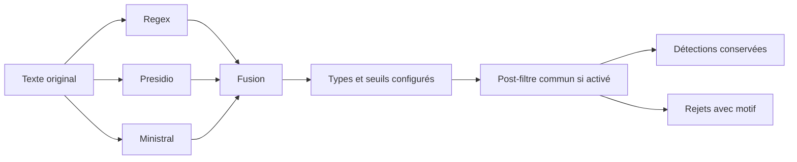

# Réduire les faux positifs sur les identifiants structurés

Recherche du 19 septembre 2026, réalisée avec `research-deep` : trois recherches indépendantes, lecture du code actuel et essais locaux reproductibles. Base Git : `280bdac1`, avec des modifications préexistantes dans le répertoire de travail. Les constats portent sur cet état local, pas sur une version déployée vérifiée.

## Recommandation

**Renforcer les validateurs déterministes communs, puis envisager de désactiver Ministral pour les cartes complètes et les IBAN complets. Conserver Presidio pour ces types, après correction de ses lacunes de couverture. Ne pas désactiver globalement Ministral pour Tax ID et les numéros sociaux internationaux.**

Les espaces et les tirets sont parfaitement gérables par regex. Le vrai problème est de reconnaître les bons séparateurs, de conserver les positions dans le texte et d'appliquer les règles du bon identifiant. Une regex vérifie une forme ; Luhn, MOD-97 ou les autres clés ajoutent une vérification. Aucun de ces contrôles ne prouve qu'un numéro a été attribué à une personne ou qu'un compte existe.

Presidio emploie déjà cette combinaison pour les cartes et les IBAN. Le remplacer par un second jeu de regex ajouterait de la maintenance sans gain automatique de précision. Ses reconnaisseurs sont toutefois perfectibles, comme le montrent les essais ci-dessous. Sources : [cartes Presidio 2.2.364](https://github.com/microsoft/presidio/blob/2.2.364/presidio-analyzer/presidio_analyzer/predefined_recognizers/generic/credit_card_recognizer.py), [IBAN Presidio 2.2.364](https://github.com/microsoft/presidio/blob/2.2.364/presidio-analyzer/presidio_analyzer/predefined_recognizers/generic/iban_recognizer.py).

| Type | Validation recommandée | Décision sur les détecteurs |
|---|---|---|
| Credit card | Extraction contrôlée, longueurs et séries prises en charge, Luhn ; contexte pour les nombres ambigus | Conserver et compléter Presidio ; désactiver `MINISTRAL:CREDIT_DEBIT_CARD` seulement après comparaison du rappel |
| IBAN | Pays du registre, longueur et structure BBAN, MOD-97 ; séparateurs de présentation explicitement tolérés | Conserver Presidio et le post-filtre ; désactiver `MINISTRAL:IBAN` après couverture des variantes |
| SSN américain | 9 chiffres, groupes interdits et préfixes exclus ; pas de clé de contrôle | Règles déterministes adaptées à `US_SSN`, sans les imposer au type social générique |
| Numéros sociaux internationaux | Validateurs nationaux : AVS, NIR, autres formats effectivement nécessaires | Conserver Ministral pour les formats non couverts et le contexte |
| Tax ID | Pays et sous-type fiables, règles nationales ; distinguer personne et entreprise | Étendre progressivement le post-filtre ; conserver le détecteur générique tant que sa couverture n'est pas remplacée |

## Ce que le dépôt fait déjà

Le [traitement gRPC](../../../pii-detector-service/pii_detector/infrastructure/adapter/in/grpc/pii_service.py) applique le post-filtre après la fusion des résultats et le filtrage par configuration. Il s'applique aux résultats des différents détecteurs, sous réserve de `postfilter_enabled=true`. En l'absence de configuration chargée, ce drapeau vaut `false` dans cette voie d'exécution.



Le [registre des stratégies](../../../pii-detector-service/pii_detector/infrastructure/postfilter/registry.py) contient déjà :

- Cartes : Luhn pour `CARD_NUMBER`, `PAYMENT_CARD`, `CREDIT_CARD` et `CREDIT_DEBIT_CARD`.
- IBAN : `python-stdnum` pour `IBAN` et `IBAN_CODE`.
- AVS suisse : EAN-13 pour `AVS_NUMBER` et `NATIONAL_ID_NUMBER`.
- Tax ID : UID suisse `CHE` + 9 chiffres, avec sa clé, pour `TAX_ID` et `TAX_NUMBER`.

**Il manque surtout une validation de forme plus exigeante et une orientation vers les bonnes règles nationales.** Les stratégies existantes rejettent principalement des clés incorrectes sur des valeurs de forme reconnue. Elles conservent les autres formes, volontairement, pour préserver les fragments et les formats étrangers.

Le [détecteur Regex](../../../pii-detector-service/config/models/regex-patterns.toml) ne contient actuellement ni extraction de carte, ni extraction d'IBAN, ni extraction générique de Tax ID. Il contient notamment les numéros sociaux français, suisses et belges. Désactiver simultanément Presidio et Ministral sur cartes/IBAN laisserait donc ces types sans extracteur dédié.

Les [données d'initialisation](../../../pii-reporting-api/src/main/resources/data.sql) activent les cartes et IBAN de Presidio et de Ministral ; `US_SSN` de Presidio est désactivé. Elles ne prouvent pas l'état de la base utilisée par ton scan : l'activation effective combine le drapeau global du détecteur et sa ligne dans `pii_type_config`. La base déployée n'a pas été interrogée durant cette étude.

## Défauts reproduits localement

Versions installées : Presidio `2.2.364`, `python-stdnum` `2.2`. Les valeurs sont des exemples publics ou synthétiques. Les observations ci-dessous proviennent du [script reproductible](probe.py) et de ses [résultats](probe-results.json).

| Cas contrôlé | Comportement actuel | Conséquence |
|---|---|---|
| IBAN suisse à clé incorrecte, compact ou avec espaces ordinaires | Rejeté par le post-filtre | Le contrôle MOD-97 fonctionne sur ces formes |
| Même IBAN incorrect avec tirets ou espaces insécables | Conservé | La normalisation ne retire que l'espace ASCII ; la valeur contourne ensuite le contrôle |
| Texte `customer reference pending` étiqueté IBAN ou Tax ID | Conservé | La présence d'une stratégie ne garantit pas une validation de forme |
| Carte à clé incorrecte, 16 chiffres | Rejetée | Luhn est bien appliqué |
| Même numéro précédé de `AB` | Conservé | La forme non numérique évite Luhn |
| Candidats carte de 12 ou 20 chiffres | Conservés | Hors de la plage de contrôle de la stratégie ; ce n'est pas une preuve de validité |
| AVS `756.9217.0769.84`, clé incorrecte | Rejeté sous `AVS_NUMBER`, conservé sous `SOCIAL_SECURITY_NUMBER` | Le libellé peut empêcher l'application du validateur adapté |
| UID suisse avec clé incorrecte | Rejeté sous `TAX_ID` | Le validateur fiscal actuel ne couvre que ce format |
| AVS valide avec points / compact / espaces / tirets | Regex extrait uniquement la forme avec points | Étendre seulement le post-filtre ne répare pas les omissions à l'extraction |
| Carte de test Mastercard `2223 0031 2200 3222` | Non extraite par Presidio | Le motif local ne couvre pas cette série commençant par 2 |
| Candidat de 19 chiffres `4000000000000000006`, Luhn correct | Non extrait par Presidio | Sa regex locale couvre au maximum 17 chiffres ; ce test ne prétend pas que ce numéro est émis |
| Carte ou IBAN avec espaces insécables | Non extrait par les reconnaisseurs Presidio testés | Variante importante pour les textes issus de HTML/PDF |
| IBAN allemand de 23 caractères, MOD-97 recalculé | Extrait par Presidio à 1,0 ; refusé par `stdnum` | Le contrôle de forme Presidio peut accepter un préfixe national sans vérifier toute la longueur |
| `900-12-3456` | Candidat Presidio `US_SSN` à 0,5 ; refusé par `stdnum.us.ssn` | Lacune du reconnaisseur, sans preuve que ce résultat franchit les seuils applicatifs |

Pour le dernier cas, les données d'initialisation désactivent `US_SSN` et fixent son seuil à 0,95. Une sortie brute du reconnaisseur n'est donc pas une détection de production démontrée.

La plage de contrôle actuelle des cartes, 13–19 chiffres, ne doit pas devenir une définition universelle du PAN. L'explication publique de l'ISO sur le passage aux IIN à huit chiffres mentionne des PAN de 10 à 19 chiffres. Il faut définir les familles de cartes recherchées avant de durcir les longueurs ; les candidats courts ne sont pas tous invalides par définition. Source : [ISO, évolution des IIN](https://www.iso.org/news/2016/11/Ref2146.html).

Attention également à [IbanStrategy](../../../pii-detector-service/pii_detector/infrastructure/postfilter/strategies/iban.py) : son commentaire présente la validation comme limitée à MOD-97/longueur, mais l'appel actuel `stdnum.iban.is_valid(s)` utilise `check_country=True` par défaut. La bibliothèque vérifie aussi la structure BBAN et, lorsqu'il existe, le module national. La recommandation est fondée sur le code appelé, pas sur ce commentaire.

## Espaces, tirets et normalisation

Pour les cartes et les IBAN, traiter séparément :

1. **Extraction dans le texte original** : regex avec frontières et séparateurs autorisés, sans absorber des lignes, des colonnes ou des nombres voisins.
2. **Normalisation du candidat seulement** : retirer les séparateurs de présentation autorisés ; conserver la valeur et les positions originales pour afficher et masquer exactement le bon passage.
3. **Validation** : forme complète, longueur, pays ou famille, puis clé de contrôle.

Les espaces insécables `U+00A0` et fines insécables `U+202F` méritent des tests dédiés. Une classe explicite est préférable à un `\s*` illimité qui peut réunir plusieurs lignes. Un tiret peut être toléré à la lecture d'un IBAN sans devenir pour autant son format officiel. Les formes compactes doivent rester prises en charge.

Ne pas appliquer une suppression universelle de tous les caractères non numériques : certains identifiants contiennent des lettres, et les marqueurs de siècle finlandais ont un sens. Ne pas ajouter une regex simplement plus large : elle peut extraire davantage de numéros de commandes, dates ou identifiants techniques.

## SSN : un libellé générique ne suffit pas

Dans [MinistralDetector](../../../pii-detector-service/pii_detector/infrastructure/detector/ministral_detector.py), `ssn` est un alias de `social_security_number`. **Il ne signifie donc pas nécessairement un SSN américain.** Le post-filtre actuel ne possède aucune stratégie pour `SSN`, `US_SSN`, `SOCIAL_SECURITY_NUMBER` ou `SOCIALNUM`.

Pour les États-Unis, les règles officielles excluent notamment `000`, `666` et `900–999` dans le premier groupe, `00` au milieu et `0000` à la fin. Le numéro n'a pas de clé de contrôle. Un simple groupe de neuf chiffres ne permet pas de déterminer s'il s'agit d'un SSN, d'un identifiant fiscal ou d'un autre numéro. Source : [SSA, structure du SSN](https://secure.ssa.gov/poms.nsf/lnx/0110201035).

Pour la Suisse, l'AVS actuel a 13 chiffres et une clé EAN-13. Pour la France, distinguer le NIR à 13 caractères et sa présentation à 15 avec clé ; préserver les cas particuliers documentés. Sources : [Centrale de compensation](https://www.zas.admin.ch/fr/numero-avs-identificateur), [INSEE, structure du NIR](https://xml.insee.fr/schema/nir.html). L'étude antérieure [Formats internationaux des numéros sociaux](../../social-security-number-formats.md) montre aussi pourquoi un minimum mondial unique serait incorrect.

La bonne extension est une sélection prudente du validateur lorsque le pays et le format sont établis, pas un alias qui soumettrait tous les numéros sociaux au validateur américain ou suisse. Un pays configuré pour le scan constitue un périmètre de recherche, pas une preuve que tous les identifiants du document viennent de ce pays.

## Tax ID : la liste Upvest est utile, mais ne suffit pas

La [page Upvest fournie](https://docs.upvest.co/products/tol/guides/users/users_tax_identification_numbers) décrit la validation d'un champ d'inscription dont le pays est connu. Elle ne fournit pas un extracteur fiable pour un document libre. Une union de motifs nationaux comme « 9, 10, 11 ou 13 chiffres » accepterait beaucoup de nombres ordinaires.

Ses alternatives ne sont pas toujours groupées sous les deux ancres : une utilisation naïve avec `search` peut reconnaître un fragment. Utiliser `fullmatch` sur le candidat évite ce problème d'ancrage, sans corriger les lacunes de couverture. Certains formats demandent des règles supplémentaires, notamment les nouveaux marqueurs de siècle finlandais. Il faut donc vérifier les motifs contre les sources nationales. Source : [gouvernement finlandais](https://valtioneuvosto.fi/-/10623/henkilotunnusten-riittavyys-varmistetaan-uusilla-valimerkeilla?languageId=en_US).

En Suisse, dans le cadre de l'échange automatique de renseignements fiscaux, distinguer le TIN d'une personne physique, lié au numéro AVS, et celui d'une entité, lié à l'UID. Le filtre `CHE` existant ne couvre pas les personnes physiques. Pour les autres pays, séparer également les identifiants personnels, les numéros fiscaux d'entreprises et les numéros de TVA. Source : [fiche suisse publiée par l'OCDE](https://www.oecd.org/tax/automatic-exchange/crs-implementation-and-assistance/tax-identification-numbers/Switzerland-TIN.pdf).

Ne pas remplacer aveuglément un reconnaisseur par `stdnum` : l'essai local montre que `stdnum.us.itin` 2.2 refuse `912-50-3456`, car il n'accepte pas le groupe `50`. Les règles IRS actuelles comprennent pourtant les groupes `50–65`. Le reconnaisseur Presidio installé contient ces groupes. Il s'agit d'une conformité de format, pas d'une affirmation d'attribution de cet exemple. Sources : [IRS Publication 4152](https://www.irs.gov/pub/irs-pdf/p4152.pdf), [code du validateur ITIN](https://github.com/arthurdejong/python-stdnum/blob/2.2/stdnum/us/itin.py).

Sans pays ou sous-type fiable, une valeur qui échoue à un validateur national reste **non déterminée**, pas nécessairement invalide. On peut néanmoins rejeter des phrases ou des artefacts techniques manifestement hors du périmètre d'identifiant retenu.

## Sources et bibliothèques à privilégier

| Source ou bibliothèque | Utilité | Limite pour ce projet |
|---|---|---|
| [Registre IBAN SWIFT](https://www.swift.com/swift-resource/9606/download) | Pays, longueurs et structures officiels | Suivre les évolutions du registre ; ne prouve pas l'existence du compte |
| [Presidio](https://github.com/microsoft/presidio) | Extracteurs avec positions, contexte et contrôles ; déjà installé | Adapter les quelques motifs défaillants et tester la version effectivement utilisée |
| [python-stdnum](https://arthurdejong.org/python-stdnum/) | Validateurs nationaux, normalisation et clés ; déjà installé | Ce n'est pas un extracteur de texte ni un registre exhaustif ; vérifier chaque module |
| [Fiche TIN suisse de l'OCDE](https://www.oecd.org/tax/automatic-exchange/crs-implementation-and-assistance/tax-identification-numbers/Switzerland-TIN.pdf) et [portail TIN de la Commission européenne](https://taxation-customs.ec.europa.eu/online-services/online-services-and-databases-taxation/taxpayer-identification-number-tin_en) | Informations par juridiction ; périmètre personnes/entités à vérifier pour chaque source | Références nationales, pas une regex globale |
| [Schwifty](https://schwifty.readthedocs.io/) | Bibliothèque spécialisée IBAN/BIC | Option de comparaison si une lacune persiste ; aucune nouvelle dépendance nécessaire pour la première amélioration |
| [validator.js, isTaxID](https://github.com/validatorjs/validator.js/blob/master/src/lib/isTaxID.js) | Autre implémentation utile pour comparer les règles | Son profil américain vise l'EIN et sa couverture ne remplace pas l'ensemble des TIN personnels ; ne pas porter cette bibliothèque JavaScript dans le service Python |
| [Gist IBAN fourni](https://gist.github.com/akndmr/7ba7af0c07a3ec517c651bc6f1c508d5) | Exemples de présentation et motif candidat | Ne remplace ni registre national ni MOD-97 ; syntaxe d'une chaîne de code à adapter avant utilisation Python |

L'article [ibanchecker.cash](https://ibanchecker.cash/blog/developer-resources/iban-regex-patterns) n'a pas pu être récupéré durant cette recherche : son contenu n'est pas présenté comme vérifié. Le gist et la page Upvest ont été lus.

Presidio déclare une [licence MIT](https://github.com/microsoft/presidio/blob/main/LICENSE) ; `python-stdnum` déclare [LGPL-2.1-or-later](https://arthurdejong.org/python-stdnum/). Aucune nouvelle dépendance n'est nécessaire pour commencer. La licence de réutilisation du gist fourni n'a pas été établie.

## Mise en œuvre minimale proposée

1. **Réparer le post-filtre commun cartes/IBAN.** Harmoniser les séparateurs acceptés et vérifier la forme entière. Réutiliser les stratégies et `stdnum` existants. Distinguer une valeur complète impossible d'un fragment ou d'une valeur masquée ; ne pas reclasser silencieusement toute forme inconnue en faux positif. Si le candidat contient un préfixe tel que `IBAN:`, isoler l'identifiant et conserver ses positions avant de décider.
2. **Compléter l'extraction existante.** Corriger les motifs Presidio concernés : cartes commençant par 2, plage de longueurs retenue, espaces insécables ; rendre la validation nationale IBAN complète. Étendre la regex AVS aux présentations compactes et espacées. Ne pas ajouter en parallèle un second extracteur global des mêmes cartes/IBAN.
3. **Étendre les règles sociales et fiscales par pays.** Commencer par les formats réellement présents dans le corpus. Ajouter les cas de validation au registre partagé, avec une sélection explicite du sous-type et des tests contre les sources nationales. Ne pas interpréter tous les `TAX_ID` comme des UID suisses.
4. **Comparer avant de retirer Ministral.** Rejouer les mêmes documents avec la configuration actuelle, puis avec les filtres renforcés, puis sans les contributions Ministral cartes/IBAN. Comparer les faux positifs et surtout les vraies valeurs trouvées uniquement par Ministral. Vérifier les drapeaux globaux, les lignes par détecteur et les alias dans la configuration effective.

La désactivation par type n'économise pas nécessairement les appels au modèle : le prompt actuel de Ministral demande toujours d'extraire les PII du texte, sans liste dynamique des seuls types actifs. Elle limite principalement les résultats retenus. Un gain de temps doit être mesuré, pas déduit du nombre de types désactivés.

Autre point à vérifier pendant cette comparaison : la [fusion](../../../pii-detector-service/pii_detector/domain/service/detection_merger.py) choisit les passages par type avant le filtrage. Une proposition plus longue ensuite rejetée ne doit pas faire perdre un candidat valide plus court déjà éliminé. Ce risque découle de l'ordre du code ; il n'est pas mesuré sur tes scans ici.

## Vérifications et limites

- **158 tests existants passent**, ciblant les stratégies, le validateur commun, le corpus de référence et son intégration gRPC.
- La sonde couvre **22 cas de post-filtrage**, **8 cas d'extraction Presidio** et **4 présentations AVS**, avec des assertions sur les défauts clés.
- Le corpus synthétique existant conserve 93 valeurs sur 95 dites « gold » ; les deux rejets sont les UID à clé artificiellement incorrecte déjà documentés par les tests. Sur les 135 résultats bruts, 14 sont rejetés. Ces nombres décrivent le comportement actuel, pas un gain de précision de la proposition.
- Aucun scan de production, aucun échantillon récent annoté et aucune configuration déployée n'ont été analysés. On ne peut donc pas chiffrer la part de tes faux positifs qui disparaîtrait, ni garantir le rappel après désactivation.
- Aucune modification des détecteurs ou de la base n'a été effectuée. Les nouveaux fichiers sont les recherches, le rapport et la sonde.

Reproduction depuis la racine du dépôt :

```bash
PYTHONPATH=pii-detector-service pii-detector-service/.venv/bin/python docs/research/pii-structured-identifiers/probe.py
```

Les assertions décrivent l'état observé le jour de l'étude : elles devront changer lorsque les défauts auront été corrigés. Les trois recherches ont passé la validation de leurs dix champs obligatoires : [cartes et IBAN](results/credit_cards_and_iban.json), [numéros sociaux](results/social_security_numbers.json), [identifiants fiscaux](results/tax_identification_numbers.json).

Les incertitudes restantes sont explicites : article IBAN inaccessible, règles historiques et territoriales non exhaustives, algorithmes nationaux parfois documentés seulement dans les bibliothèques, mise à jour exhaustive des tables de pays non vérifiée et rappel sur tes documents non mesuré. Les versions locales ont été vérifiées par la sonde, même lorsque les recherches web indépendantes les indiquent comme inconnues.
